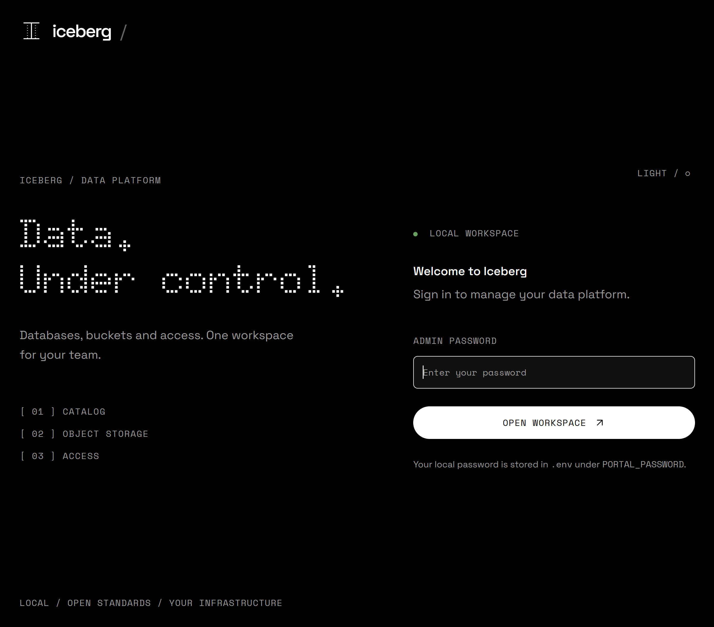

# Iceberg Data Platform

**An open lakehouse you actually own.** Apache Iceberg as the table format, with every other building block open source and replaceable. It runs on a laptop with one command, or on a Kubernetes cluster with Helm.

Getting started with Iceberg takes more than a table format. You need a catalog, object storage, identity, an engine and a place to work. Vendors make that part easy, and that is usually where lock-in starts. This platform shows the other route: Apache Polaris, Keycloak, RustFS, PostgreSQL, marimo and DuckDB, connected through open interfaces (Iceberg REST, S3, OIDC and MCP). You can replace one block without touching the others.

Teams create, own and share their databases. People, notebooks and AI agents all sign in through Keycloak and work with the same grants.

## Use it as
- **A reference architecture.** See how catalog, storage, identity and engines fit together with team ownership, data sharing and AI agents on one identity. Every choice and boundary is documented, so you can reuse what fits your own platform.
- **A classroom.** Install it on Kubernetes and let the demo-company skill set up a fictional company for up to 48 participants, with one account each and a sign-in slip to hand out. See [run a class](https://sanderdw.github.io/iceberg-data-platform/run-a-class/).
- **A personal lab.** Learn Iceberg hands-on: create tables in a notebook, follow a query from the catalog to the Parquet files, and try snapshots, branches and Iceberg v3 with no cloud account or trial clock.

---

[](https://www.youtube.com/watch?v=T8D3tp1hWQk "Apache Iceberg Data Platform - An open source lakehouse you actually own")

More videos are in the [YouTube playlist](https://www.youtube.com/playlist?list=PLZGAfmMjv2lQ): an end-to-end demo from install to Conversational BI, Apache Iceberg explained from Parquet file to catalog, and short demos of semantic models and Conversational BI. The end-to-end demo and the explainer are also in Dutch.

## What it does
- **Administration portal:** manage teams, users with a role per team, databases and data shares, and browse every Polaris catalog.
- **User portal:** sign in with Keycloak, pick a team and environment, and manage databases, browse catalogs, open notebooks and share data.
- **Catalog details:** table schemas, snapshots, branches and tags, partitioning, view SQL and a 100-row preview, plus semantic models with a diagram of their datasets and relationships, all with your own permissions.
- **Data shares:** share selected tables, views and semantic models with another team or with an external party, who gets a credential and a DuckDB script, or list them in a data catalog, metadata only.
- **Team notebooks:** one shared marimo filespace per team and environment. Each user's execution is isolated and uses that user's own permissions. Eleven example notebooks cover PyIceberg, DuckDB, Iceberg v3, two data products whose semantic models live in Polaris (one with DuckDB, one with Polars), loading API data with dlt, and how Iceberg works under the hood.
- **MCP servers:** AI agents such as Claude Code sign in through Keycloak to explore data and semantic models, manage databases and data shares, or administer the platform.
- **Extensions:** add Conversational BI, a chat over your semantic models, dbt pipelines that agents build and test on your tables, Ingestion (dlt) that loads APIs, databases and files into them, and OpenMetadata, which lists your data products in a data catalog. Each is released on its own; see [extensions](https://sanderdw.github.io/iceberg-data-platform/extensions/).

This is an **educational development platform**, not an audited production service. Read [the security model](https://sanderdw.github.io/iceberg-data-platform/security/) before deploying it elsewhere.

## Quick start

Install Docker with Compose v2 (Docker Desktop on macOS/Windows), then run:

```bash
# Linux / macOS
curl -fsSL https://github.com/sanderdw/iceberg-data-platform/releases/latest/download/install.sh | sh
```

```powershell
# Windows PowerShell
irm https://github.com/sanderdw/iceberg-data-platform/releases/latest/download/install.ps1 | iex
```

The installer creates `~/iceberg-data-platform`, generates `.env`, pulls the images and starts the platform. Open http://localhost:3000 and follow the [first steps](https://sanderdw.github.io/iceberg-data-platform/first-steps/).

On a Kubernetes cluster, install the Helm chart instead; see [Install on Kubernetes](https://sanderdw.github.io/iceberg-data-platform/install-kubernetes/).

## Documentation

The documentation is at **https://sanderdw.github.io/iceberg-data-platform/**.

- [Installation](https://sanderdw.github.io/iceberg-data-platform/install/): pinned versions, branch previews, updates and stopping
- [Install on Kubernetes](https://sanderdw.github.io/iceberg-data-platform/install-kubernetes/): the Helm charts, managed PostgreSQL and the official Apache Polaris chart
- [First steps](https://sanderdw.github.io/iceberg-data-platform/first-steps/) and the [services](https://sanderdw.github.io/iceberg-data-platform/reference/services/)
- Use the platform: [user portal](https://sanderdw.github.io/iceberg-data-platform/user-portal/), [notebooks](https://sanderdw.github.io/iceberg-data-platform/notebooks/), [semantic models](https://sanderdw.github.io/iceberg-data-platform/semantic-models/), [data shares](https://sanderdw.github.io/iceberg-data-platform/data-shares/), [your own tools](https://sanderdw.github.io/iceberg-data-platform/connect/) and [AI agents](https://sanderdw.github.io/iceberg-data-platform/ai-agents/)
- [Administration guide](https://sanderdw.github.io/iceberg-data-platform/admin-guide/), [configuration](https://sanderdw.github.io/iceberg-data-platform/configuration/) and the [security model](https://sanderdw.github.io/iceberg-data-platform/security/)
- [Extensions](https://sanderdw.github.io/iceberg-data-platform/extensions/): Conversational BI, dbt pipelines, Ingestion (dlt) and OpenMetadata
- [Develop](https://sanderdw.github.io/iceberg-data-platform/develop/): principles, [run from source](https://sanderdw.github.io/iceberg-data-platform/develop/run-from-source/), [contributing](https://sanderdw.github.io/iceberg-data-platform/develop/contributing/), architecture and internals
- [Changelog](https://sanderdw.github.io/iceberg-data-platform/changelog/)
- [Presentation](https://sanderdw.github.io/iceberg-data-platform/presentation/)

The pages are in [`docs/`](docs/), built with [Zensical](https://zensical.org).

## License

Application source is licensed under [Apache-2.0](LICENSE). Bundled fonts retain their [third-party licenses](THIRD_PARTY_NOTICES.md). This is an independent project, not an Apache Software Foundation project.
