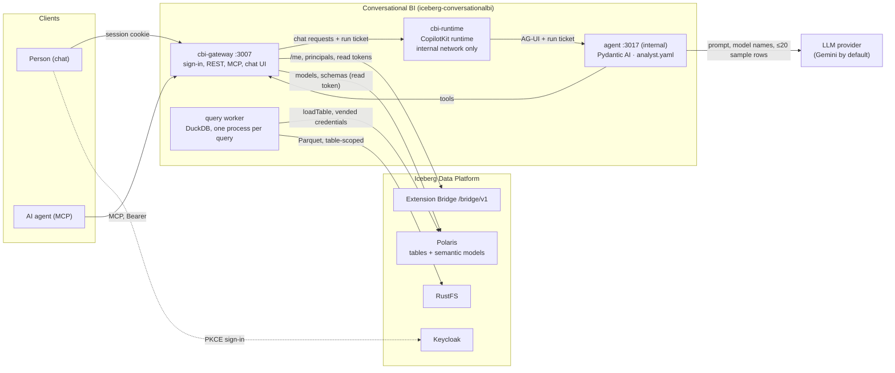
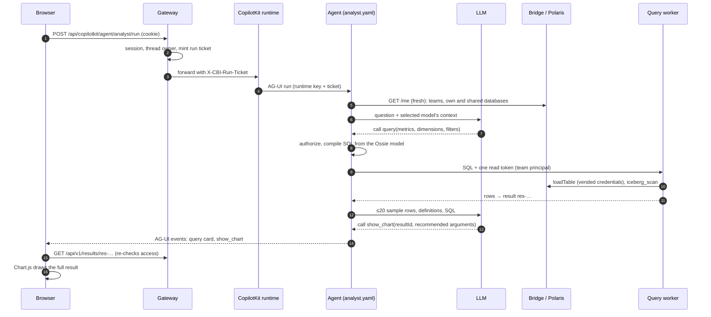

# Conversational BI internals

How the [Conversational BI](../conversational-bi.md) extension is built. Its source is in [`extensions/conversationalbi`](https://github.com/sanderdw/iceberg-data-platform/tree/main/extensions/conversationalbi): its own Compose project (`iceberg-conversationalbi`) and Helm chart (`deploy/helm/iceberg-conversationalbi`, where a NetworkPolicy takes the place of the internal chat network), dependencies, images, version and releases. It uses the platform only through the [Extension Bridge](extension-bridge.md), Iceberg REST and S3.

| | |
| --- | --- |
| Chat | CopilotKit v2 generative UI, Chart.js, Nothing design |
| Agent | Pydantic AI, defined in YAML ([`analyst.yaml`](https://github.com/sanderdw/iceberg-data-platform/blob/main/extensions/conversationalbi/conversationalbi/agent/analyst.yaml)), served over AG-UI |
| API | [OpenAPI contract](https://github.com/sanderdw/iceberg-data-platform/blob/main/extensions/conversationalbi/contracts/conversationalbi-api/v1/openapi.yaml) |
| Engine | DuckDB 2.0.0 with `iceberg_scan`, in a disposable, locked-down process per query |
| Bridge | contract `>=0.1,<0.2`; shared models need capability `shared-data` |

## Architecture



One question, step by step:



## Install from source

From the platform directory, register the extension. This creates its Keycloak clients and writes
the handshake file:

```bash
uv run python -m scripts.setup --extension conversationalbi --origin http://localhost:3007 \
  --handshake extensions/conversationalbi/.env.bridge
docker compose up -d --wait
docker compose -f compose.users.yaml up -d --wait users
```

Then in `extensions/conversationalbi`:

```bash
uv sync
uv run python -m scripts.setup        # asks for the model and its key; stored in llm.env (0600)
docker compose build && docker compose up -d --wait
```

Unattended, pass them instead: `LLM_MODEL=anthropic:claude-sonnet-5-5 ANTHROPIC_API_KEY=… uv run
python -m scripts.setup`.

For a demo on a platform set up with `scripts.setup --demo`, `uv run --all-groups python -m
scripts.flights_seed --own demo-demo` (platform directory) publishes the flights product in a partner team, shares it with demo-team, and gives
demo-team its own copy too.

## Configuration

`scripts.setup` writes `llm.env` (mode 0600), which only the gateway reads; the providers are listed under [change the model](../conversational-bi.md#change-the-model). In a source checkout, restart the gateway with `docker compose up -d --wait cbi-gateway`. For the other options see [`.env.example`](https://github.com/sanderdw/iceberg-data-platform/blob/main/extensions/conversationalbi/.env.example). The agent is [`conversationalbi/agent/analyst.yaml`](https://github.com/sanderdw/iceberg-data-platform/blob/main/extensions/conversationalbi/conversationalbi/agent/analyst.yaml), a [Pydantic AI agent spec](https://pydantic.dev/docs/ai/core-concepts/agent-spec/): change its instructions or model settings there. The `SemanticLayer` capability adds the data tools.

## Development

```bash
uv run pytest && uv run ruff check .          # gateway, agent, compiler, worker
(cd web && npm ci --ignore-scripts && npm test && npm run build)
uv run python -m tests.dev_server              # real gateway + agent, platform faked
(cd runtime && npm ci --ignore-scripts && RUNTIME_KEY=kkkkkkkkkkkkkkkkkkkkkkkkkkkkkkkk AGENT_URL=http://127.0.0.1:3017/ node server.mjs)
node scripts/cbi-browser.mjs                   # browser check against http://localhost:3007
uv run python -m scripts.api_contract          # after API changes
```

`LLM_MODEL=test:flights` with `BI_ALLOW_TEST_MODEL=1` replaces the LLM with a scripted agent for
tests and CI. `scripts/e2e_smoke.py` checks a live installation through MCP.
