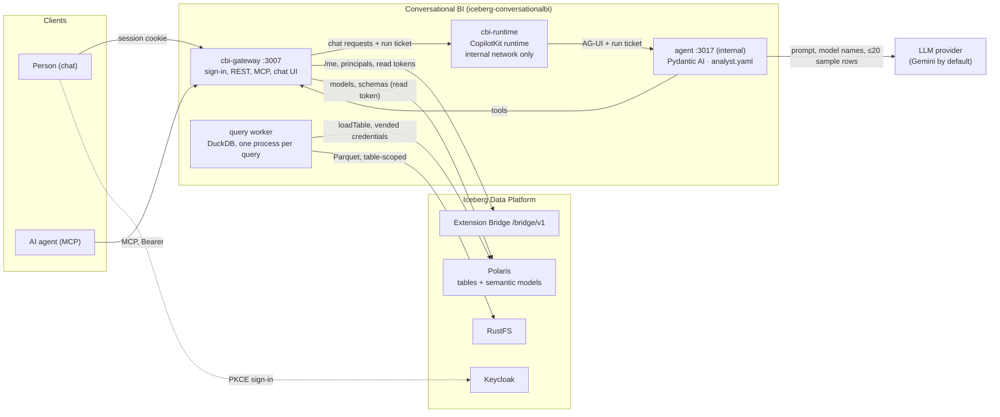
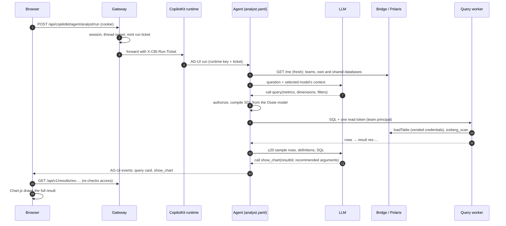

# Conversational BI internals

How the [Conversational BI](../conversational-bi.md) extension is built. Its source is in [`extensions/conversationalbi`](https://github.com/sanderdw/iceberg-data-platform/tree/main/extensions/conversationalbi): its own Compose project (`iceberg-conversationalbi`) and Helm chart (`deploy/helm/iceberg-conversationalbi`, where a NetworkPolicy takes the place of the internal chat network), dependencies, images, version and releases. It uses the platform only through the [Extension Bridge](extension-bridge.md), Iceberg REST and S3.

| | |
| --- | --- |
| Chat | CopilotKit v2 generative UI, Chart.js, Nothing design |
| Agent | Pydantic AI, defined in YAML ([`analyst.yaml`](https://github.com/sanderdw/iceberg-data-platform/blob/main/extensions/conversationalbi/conversationalbi/agent/analyst.yaml)), served over AG-UI |
| API | [OpenAPI contract](https://github.com/sanderdw/iceberg-data-platform/blob/main/extensions/conversationalbi/contracts/conversationalbi-api/v1/openapi.yaml) |
| Engine | DuckDB 2.0.0 with `iceberg_scan`, in a disposable, locked-down process per query |
| Bridge | contract `>=1.0,<2`; shared models need capability `shared-data` |

## Architecture



One question, step by step:



## Install from source

From the platform directory, register the extension. This creates its Keycloak clients and writes
the handshake file:

```bash
uv run python -m scripts.setup --extension conversationalbi --origin http://localhost:3007 \
  --handshake extensions/conversationalbi/.env.bridge
docker compose up -d --wait
docker compose -f compose.users.yaml up -d --wait users
```

Then in `extensions/conversationalbi`:

```bash
uv sync
uv run python -m scripts.setup        # asks for the model and its key; stored in llm.env (0600)
docker compose build && docker compose up -d --wait
```

Unattended, pass them instead: `LLM_MODEL=anthropic:claude-sonnet-5-5 ANTHROPIC_API_KEY=… uv run
python -m scripts.setup`.

For a demo on a platform set up with `scripts.setup --demo`, `uv run --all-groups python -m
scripts.flights_seed --own demo-demo` (platform directory) publishes the flights product in a partner team, shares it with demo-team, and gives
demo-team its own copy too.

## Configuration

`scripts.setup` writes `llm.env` (mode 0600), which only the gateway reads; the providers are listed under [change the model](../conversational-bi.md#change-the-model). In a source checkout, restart the gateway with `docker compose up -d --wait cbi-gateway`. For the other options see [`.env.example`](https://github.com/sanderdw/iceberg-data-platform/blob/main/extensions/conversationalbi/.env.example). The agent is [`conversationalbi/agent/analyst.yaml`](https://github.com/sanderdw/iceberg-data-platform/blob/main/extensions/conversationalbi/conversationalbi/agent/analyst.yaml), a [Pydantic AI agent spec](https://pydantic.dev/docs/ai/core-concepts/agent-spec/): change its instructions or model settings there. The `SemanticLayer` capability adds the data tools.

## Development

```bash
uv run pytest && uv run ruff check .          # gateway, agent, compiler, worker
(cd web && npm ci --ignore-scripts && npm test && npm run build)
uv run python -m tests.dev_server              # real gateway + agent, platform faked
(cd runtime && npm ci --ignore-scripts && RUNTIME_KEY=kkkkkkkkkkkkkkkkkkkkkkkkkkkkkkkk AGENT_URL=http://127.0.0.1:3017/ node server.mjs)
node scripts/cbi-browser.mjs                   # browser check against http://localhost:3007
uv run python -m scripts.api_contract          # after API changes
```

`LLM_MODEL=test:flights` with `BI_ALLOW_TEST_MODEL=1` replaces the LLM with a scripted agent for
tests and CI. `scripts/e2e_smoke.py` checks a live installation through MCP.

### API and MCP conventions

The REST API, the MCP server and the chat agent share one service layer (`conversationalbi/services.py`), and a tool returns what its REST operation returns. `query_semantic_model` and `get_result` are the exception: they answer with the sample for an LLM (`Services.for_llm`), and `GET /api/v1/results/{result}` has every row.

- Every response is built by a projection (`public_me`, `public_environment`, `list_semantic_models`, `public_conversation`). No Bridge response and no stored row is passed on as it is.
- Stored times are seconds since 1970, and Iceberg's are milliseconds; `timestamp()` turns them into RFC 3339 strings in UTC with milliseconds.
- REST bodies, query parameters and responses are camelCase; tool names and tool parameters are snake_case. A governed query (`QuerySpec`) is a document format that question sets store, so it keeps `order_by` in REST as well.
- A list is an object with one plural key. A semantic model is `model` beside `database` and `namespace`, a result is `result`; no parameter is called `id` or `name`.
- Every error, including an unknown path, a wrong method and an unexpected exception, is `{"error", "code", "detail"}`.
- `conversationalbi/api.py` declares response models for `whoami`, the environments and the list of semantic models. Add each new key there: a key the model does not declare is left out of the REST response, and `tests/test_api.py` compares each tool's result with the REST body.
- The chat agent's own tools (`list_models`, `select_model`, `describe_model`, `query` in `agent/capability.py`) are not part of this API and keep their names: the agent's prompt and the Evaluations scorers use them.

### The evaluation API

`/api/v1/evaluation/*` (`conversationalbi/evaluation.py`) is for the Evaluations extension's service account only, and is part of the same contract file. Every operation is a `POST` with `team` and `environment` in the body, and a field it does not know is refused.

| Operation | Request, beside `team` and `environment` | Response |
| --- | --- | --- |
| `/models` | | `{semanticModels: [{model, name, databaseName, environment, shared}], llmModels, schemaOnly}` |
| `/ask` | `question`, `llmModel` (optional) | `{answer, llmModel, toolCalls, queries, usage {inputTokens, outputTokens, requests}, durationMs, traceId}` |
| `/ask-schema-only` | `model`, `question`, `llmModel` (optional) | As `/ask`; 409 `schema_only_disabled` without `BI_EVAL_SCHEMA_ONLY` |
| `/query` | `model`, `spec` (a governed query) | `{modelName, query, columns, rows, rowCount, truncated, joinPaths, sql, dataAsOf}` |
| `/recording` | `enabled` | `{recording, retentionDays}` |
| `/conversations` | `since` (optional), `limit` | `{conversations: [...], recording, retentionDays}` |

- `model` is always a semantic model, by its reference `{database, namespace, name}`; `llmModel` names an LLM. An LLM outside `LLM_MODEL` and `BI_EVAL_MODELS` is 422 `unknown_llm_model`.
- `toolCalls[].args` and `queries[].spec` are the chat agent's tool arguments, as the agent sent them.
- A conversation is `{id, at, team, environment, model, question, answer, toolCalls, queries, llmModel, inputTokens, outputTokens, traceId}`. Who asked is neither returned nor recorded: the `user` column of `conversations.sqlite3` stays empty.
- `at` is an RFC 3339 time with milliseconds and the cursor: pass the last one read as `since` to get only later conversations, oldest first. Within a team environment no two conversations share a millisecond, and `since` is compared to the millisecond, so a page never repeats or skips one.
