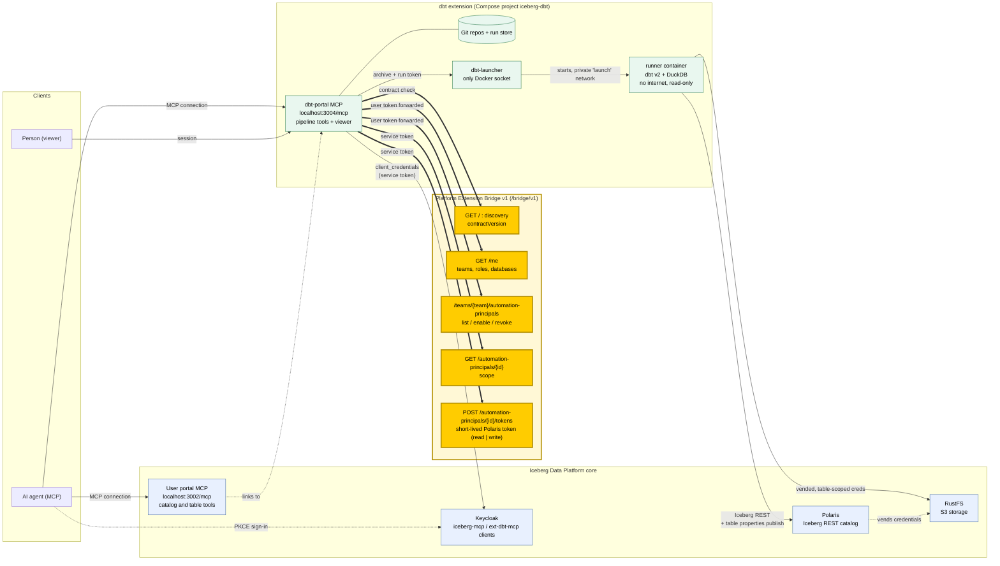
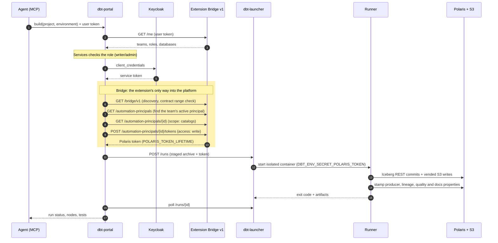

# dbt internals

How the [dbt pipelines](../dbt.md) extension is built. Its source is in [`extensions/dbt`](https://github.com/sanderdw/iceberg-data-platform/tree/main/extensions/dbt): its own Compose project (`iceberg-dbt`), dependencies, images, version and releases. It uses the platform only through the [Extension Bridge](extension-bridge.md) v1, Iceberg REST and S3, so the platform and this extension upgrade independently.

| | |
| --- | --- |
| Engine | dbt v2 OSS 2.0.5 (Apache-2.0) with its built-in DuckDB adapter, DuckDB 1.5.5, Iceberg REST catalogs |
| API | [OpenAPI contract](https://github.com/sanderdw/iceberg-data-platform/blob/main/extensions/dbt/contracts/dbt-api/v1/openapi.yaml) |
| Agent skill | [`skills/dbt-platform/SKILL.md`](https://github.com/sanderdw/iceberg-data-platform/blob/main/extensions/dbt/skills/dbt-platform/SKILL.md) |
| Decisions | [`DECISIONS.md`](https://github.com/sanderdw/iceberg-data-platform/blob/main/extensions/dbt/DECISIONS.md), including why `main` is the default for terminal commands |

## Architecture

The extension reaches the platform core only through the Extension Bridge (highlighted), Iceberg REST and S3.



A build, step by step:



## Runs

- **Credentials.** Each run receives a Polaris token from the Bridge, `write` for `build`/`run`/`seed` and `read` for everything else. Storage uses Polaris-vended, table-scoped credentials. The extension never holds a platform secret beyond its own Keycloak client.
- **Isolation.** A run is one container from the pinned runner image, started by the launcher (the only container with the Docker socket). The container has a read-only root, no capabilities and no internet. It sits on a private network with only the catalog and storage. Two builds of the same project and environment never overlap.
- **Capacity.** At most `MAX_CONCURRENT_RUNS` runs (default 4) run at once across all teams, and at most `MAX_RUNS_PER_TEAM` (default 2) of one team, so one team cannot take every slot. A waiting build holds no slot. Each run gets `RUN_MEMORY` (2g) and `RUN_CPUS` (2). Logs and files are kept for the newest `RUN_RETENTION` (30) finished runs per project and environment, plus the run the pipeline is drawn from and the newest docs; older runs keep their status and results.
- **Pipelines** are drawn from dbt v2's Parquet information schema (`--generate-info-schema`).

## Install from source

From the platform directory, with the platform running:

```bash
uv run python -m scripts.setup --extension dbt --origin http://localhost:3004 --handshake extensions/dbt/.env.bridge
docker compose up -d --wait                                  # registers the dbt Keycloak clients
docker compose -f compose.users.yaml up -d --wait users      # the user portal links to dbt
cd extensions/dbt
uv run python -m scripts.setup                               # writes .env for this extension
docker compose --profile images build
docker compose up -d --wait
```

Then a team administrator enables dbt for an environment, either through an agent
(`enable_environment`) or with `POST /api/v1/teams/{team}/environments/development`.

## Development

```bash
uv sync
uv run pytest && uv run ruff check .
uv run python -m scripts.api_contract    # after an API change; review contracts/dbt-api/v1/openapi.yaml
```

A run ends 15 minutes before its catalog token expires; `RUN_TIMEOUT_SECONDS` can only lower that. All runs share the Docker host of the extension; see the [Kubernetes design](https://github.com/sanderdw/iceberg-data-platform/blob/main/extensions/dbt/DECISIONS.md#run-jobs-on-kubernetes-proposed-for-dbt-020-2026-10-07) for running them elsewhere.
