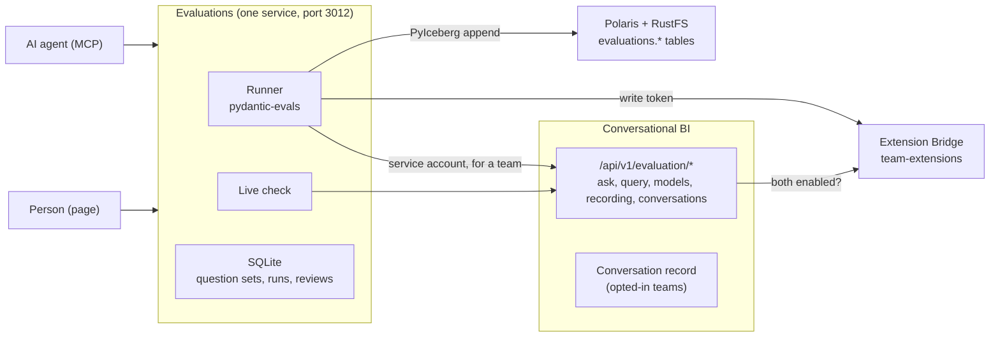

# Evaluations internals

How the [Evaluations](../evaluations.md) extension is built. Its source is in [`extensions/evaluations`](https://github.com/sanderdw/iceberg-data-platform/tree/main/extensions/evaluations): its own Compose project (`iceberg-evaluations`), dependencies, image, version and releases. It uses the platform only through the [Extension Bridge](extension-bridge.md) v1 (contract 1.0 or later) and Conversational BI only through its evaluation API.

| | |
| --- | --- |
| Engine | [pydantic-evals](https://ai.pydantic.dev/evals/) (MIT): datasets, the run loop and the LLM judge |
| API | [OpenAPI contract](https://github.com/sanderdw/iceberg-data-platform/blob/main/extensions/evaluations/contracts/evaluations-api/v1/openapi.yaml) |
| Agent skill | [`skills/agent-evaluations/SKILL.md`](https://github.com/sanderdw/iceberg-data-platform/blob/main/extensions/evaluations/skills/agent-evaluations/SKILL.md) |
| Decisions | [`DECISIONS.md`](https://github.com/sanderdw/iceberg-data-platform/blob/main/extensions/evaluations/DECISIONS.md), including why no evaluation server is bundled |

## Architecture



- **Asking for a team.** Evaluations calls Conversational BI's `/api/v1/evaluation/*` with its own Keycloak service-account token. Conversational BI accepts it only there, only for callers in `BI_AGENT_CALLERS`, and only after the Bridge capability `team-extensions` confirms that the team enabled both extensions in that environment. It then reads with its own automation principal: the scope every team member has.
- **A run.** `runner.py` builds a pydantic-evals `Dataset` from the question set's version. Its task asks `/evaluation/ask` and computes the expected query with `/evaluation/query`. The scorers in `scorers.py` compare them. Case results go to SQLite; the run then appends `evaluations.runs` and `evaluations.case_results` to the target database with a write token of Evaluations' automation principal (`lakehouse.py`), and publishes the semantic model `evaluation_results`. Only then is the run `done`.
- **The control arm.** `measure_semantic_model` starts a paired `control` and `semantic` run. The control arm calls `/evaluation/ask-schema-only`: a second Pydantic AI agent (`agent/control.py`) with only table and column names and one `run_sql` tool, guarded by `semantic/sql_guard.py`. Only for this arm does the worker return binder, catalog and parser errors, so the LLM can correct its SQL as the semantic arm reads its error codes. `compare_runs` across arms scores on the checks both have and reports `uplift`.
- **Live evaluation.** `live.py` pages through `/evaluation/conversations` since its watermark, scores a deterministic sample and queues failures as reviews. The watermark is stored in seconds and never shown; Conversational BI takes it as `since` and gives each conversation's `at` as RFC 3339 strings. Conversational BI records a chat turn only while live evaluation is on for the team and environment of the model it used (`conversationalbi/conversations.py`), and never who asked: `update_live_evaluation` calls `/evaluation/recording`, and switching it off deletes the record. A check sends it again when Conversational BI reports that it is not recording.
- **Telemetry.** A run is a span `evaluate <set>` with a span per case; httpx carries the trace into Conversational BI, so its agent run nests under the case. Scores are `gen_ai.evaluation.result` log events on the case span, sent to OpenTelemetry only.

### API and MCP conventions

The REST API and the MCP server share one service layer (`evaluations/services.py`), and a tool returns what its REST operation returns.

- Every response is built by a projection (`public_set`, `public_run`, `public_case`, `public_schedule`, `public_live`, `public_review`, `public_me`, `public_environment`). No stored row, and no answer of the Bridge or of Conversational BI, is passed on as it is.
- Storage keeps its own names and values, so a change of shape needs no migration. Stored times are seconds since 1970, and `timestamp()` turns them into RFC 3339 strings in UTC with milliseconds. A finished run is stored as `done` and shown as `success`. Who started a run is stored as one text (`alice (via agent)`, `schedule sch-…`) and shown as `triggeredBy`, `agent`, `scheduled` and `schedule`.
- REST bodies, query parameters and responses are camelCase; tool names and tool parameters are snake_case. An LLM is `llmModel`; `model` is a semantic model reference.
- A list is an object with one plural key. A `limit` outside its range is refused with 422 `invalid_request`.
- The operations that start runs return 202 with the runs, queued. A run has no `wait` and no cancel: it runs in this process and ends by itself. Its answers are `cases`, on `GET /runs/{run}` only.
- Every error, including an unknown path, a wrong method and an unexpected exception, is `{"error", "code", "detail"}`.
- `evaluations/api.py` declares a response model for every operation. Add each new key there: a key the model does not declare is left out of the REST response, and `tests/test_api.py` compares each tool's result with the REST body.
- `evaluations/agent_client.py` is the client of Conversational BI's evaluation API. `tests/test_agent_client.py` checks its requests, and the fake of that API in `tests/conftest.py`, against Conversational BI's contract (`extensions/conversationalbi/contracts/conversationalbi-api/v1/openapi.yaml`); it is skipped where that file is not checked out.

## Install from source

From the platform directory, with the platform and Conversational BI running:

```bash
uv run python -m scripts.setup --extension evaluations --origin http://localhost:3012 --handshake extensions/evaluations/.env.bridge
docker compose up -d --wait                                  # registers the Evaluations Keycloak clients
docker compose -f compose.users.yaml up -d --wait users      # the user portal links to Evaluations
cd extensions/evaluations
uv run python -m scripts.setup                               # writes .env for this extension
docker compose up -d --build --wait
```

## Development

```bash
uv sync
uv run pytest && uv run ruff check .
uv run python -m scripts.api_contract    # after an API change; review contracts/evaluations-api/v1/openapi.yaml
```

`scripts/e2e_smoke.py` checks a live installation. Prepare it as CI does (`.github/workflows/evaluations-ci.yml`): the flights product with `scripts.flights_seed --own demo-demo`, demo-admin an administrator of demo-team, and Conversational BI with the scripted model (`LLM_MODEL=test:flights`, `BI_ALLOW_TEST_MODEL=1`) and the control arm allowed (`BI_EVAL_SCHEMA_ONLY=true`; without it the smoke skips the control arm). That model answers every question with the average departure delay by carrier, so exactly 1 of the 25 flights cases passes.
