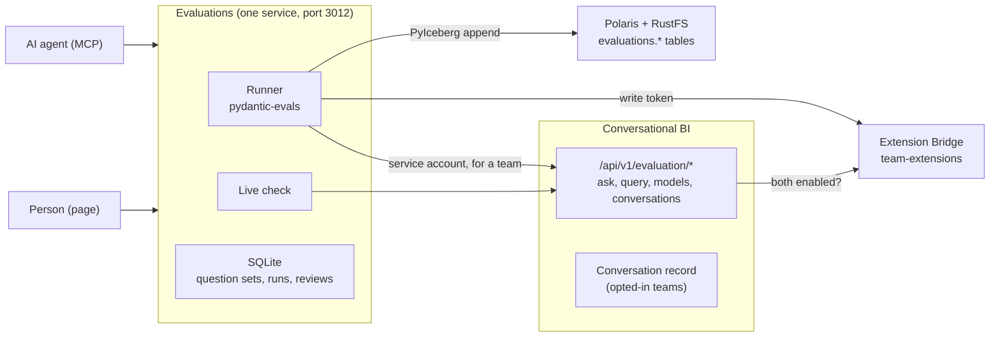

# Evaluations internals

How the [Evaluations](../evaluations.md) extension is built. Its source is in [`extensions/evaluations`](https://github.com/sanderdw/iceberg-data-platform/tree/main/extensions/evaluations): its own Compose project (`iceberg-evaluations`), dependencies, image, version and releases. It uses the platform only through the [Extension Bridge](extension-bridge.md) v1 (contract 0.1.3 or later) and Conversational BI only through its evaluation API.

| | |
| --- | --- |
| Engine | [pydantic-evals](https://ai.pydantic.dev/evals/) (MIT): datasets, the run loop and the LLM judge |
| API | [OpenAPI contract](https://github.com/sanderdw/iceberg-data-platform/blob/main/extensions/evaluations/contracts/evaluations-api/v1/openapi.yaml) |
| Agent skill | [`skills/agent-evaluations/SKILL.md`](https://github.com/sanderdw/iceberg-data-platform/blob/main/extensions/evaluations/skills/agent-evaluations/SKILL.md) |
| Decisions | [`DECISIONS.md`](https://github.com/sanderdw/iceberg-data-platform/blob/main/extensions/evaluations/DECISIONS.md), including why no evaluation server is bundled |

## Architecture



- **Asking for a team.** Evaluations calls Conversational BI's `/api/v1/evaluation/*` with its own Keycloak service-account token. Conversational BI accepts it only there, only for callers in `BI_AGENT_CALLERS`, and only after the Bridge capability `team-extensions` confirms that the team enabled both extensions in that environment. It then reads with its own automation principal: the scope every team member has.
- **A run.** `runner.py` builds a pydantic-evals `Dataset` from the question set's version. Its task asks `/evaluation/ask` and computes the expected query with `/evaluation/query`. The scorers in `scorers.py` compare them. Case results go to SQLite; the run then appends `evaluations.runs` and `evaluations.case_results` to the target database with a write token of Evaluations' automation principal (`lakehouse.py`), and publishes the semantic model `evaluation_results`. Only then is the run `done`.
- **The control arm.** `measure_semantic_model` starts a paired `control` and `semantic` run. The control arm calls `/evaluation/ask-schema-only`: a second Pydantic AI agent (`agent/control.py`) with only table and column names and one `run_sql` tool, guarded by `semantic/sql_guard.py`. Only for this arm does the worker return binder, catalog and parser errors, so the LLM can correct its SQL as the semantic arm reads its error codes. `compare_runs` across arms scores on the checks both have and reports `uplift`.
- **Live evaluation.** `live.py` pages through `/evaluation/conversations` since its watermark, scores a deterministic sample and queues failures as reviews. Conversational BI records a chat turn only when the team enabled Evaluations for the environment of the model it used (`conversationalbi/conversations.py`).
- **Telemetry.** A run is a span `evaluate <set>` with a span per case; httpx carries the trace into Conversational BI, so its agent run nests under the case. Scores are `gen_ai.evaluation.result` log events on the case span, sent to OpenTelemetry only.

## Install from source

From the platform directory, with the platform and Conversational BI running:

```bash
uv run python -m scripts.setup --extension evaluations --origin http://localhost:3012 --handshake extensions/evaluations/.env.bridge
docker compose up -d --wait                                  # registers the Evaluations Keycloak clients
docker compose -f compose.users.yaml up -d --wait users      # the user portal links to Evaluations
cd extensions/evaluations
uv run python -m scripts.setup                               # writes .env for this extension
docker compose up -d --build --wait
```

## Development

```bash
uv sync
uv run pytest && uv run ruff check .
uv run python -m scripts.api_contract    # after an API change; review contracts/evaluations-api/v1/openapi.yaml
```

`scripts/e2e_smoke.py` checks a live installation. Prepare it as CI does (`.github/workflows/evaluations-ci.yml`): the flights product with `scripts.flights_seed --own demo-demo`, demo-admin an administrator of demo-team, and Conversational BI with the scripted model (`LLM_MODEL=test:flights`, `BI_ALLOW_TEST_MODEL=1`) and the control arm allowed (`BI_EVAL_SCHEMA_ONLY=true`; without it the smoke skips the control arm). That model answers every question with the average departure delay by carrier, so exactly 1 of the 25 flights cases passes.
