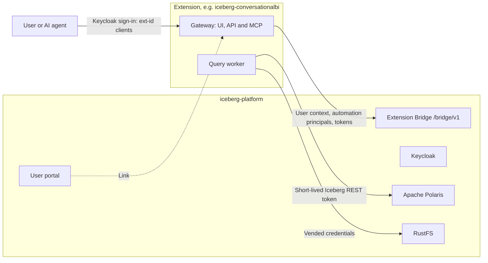

# Extension Bridge

Larger capabilities, such as conversational BI, dbt pipelines and ingestion with dlt, live in [extensions](../extensions.md). Each one has its own Compose project, dependencies, images, version, changelog and CI, and talks to the core only through the **Extension Bridge**. The core and an extension are released independently and work together as long as both support the same contract version.



## The contract

The [Extension Bridge contract](https://github.com/sanderdw/iceberg-data-platform/blob/main/contracts/bridge/README.md) ships with every core release. It gives an extension the signed-in user's teams and databases, and automation principals: service accounts that act for one team in one environment, enabled only by that team's Administrators, with short-lived catalog tokens whose lifetime the platform sets (`POLARIS_TOKEN_LIFETIME`, one hour by default; each token reports it in `expiresIn`). Team shares the team received reach their read role. Extensions sign in through their own Keycloak clients, whose tokens Polaris refuses. Any producer may describe a table with the [table-property conventions](https://github.com/sanderdw/iceberg-data-platform/blob/main/contracts/bridge/v1/table-properties.md), which the catalog shows as **Produced by**. See the [resource model](resource-model.md#automation-principals) for how automation principals are stored, and [COMPATIBILITY.md](https://github.com/sanderdw/iceberg-data-platform/blob/main/contracts/bridge/COMPATIBILITY.md) for versioning. Changes are listed in the [contract changelog](https://github.com/sanderdw/iceberg-data-platform/blob/main/contracts/bridge/CHANGELOG.md).

## Register an extension

```bash
uv run python -m scripts.setup --extension conversationalbi --origin http://localhost:3007 --handshake extensions/conversationalbi/.env.bridge
docker compose up -d --wait
docker compose -f compose.users.yaml up -d --wait users
```

Recreating the platform services creates the extension's Keycloak clients and adds a link in the user portal. On the administration portal's Teams page, platform administrators see every automation principal and can revoke it. `--remove-extension <id>` unregisters an extension; its clients are disabled on the next start.

## Extensions in this repository

| Extension | Folder | Internals |
| --- | --- | --- |
| Conversational BI | [`extensions/conversationalbi`](https://github.com/sanderdw/iceberg-data-platform/tree/main/extensions/conversationalbi) | [Conversational BI](conversational-bi.md) |
| dbt pipelines | [`extensions/dbt`](https://github.com/sanderdw/iceberg-data-platform/tree/main/extensions/dbt) | [dbt pipelines](dbt.md) |
| Ingestion (dlt) | [`extensions/ingestion`](https://github.com/sanderdw/iceberg-data-platform/tree/main/extensions/ingestion) | [Ingestion (dlt)](ingestion.md) |
