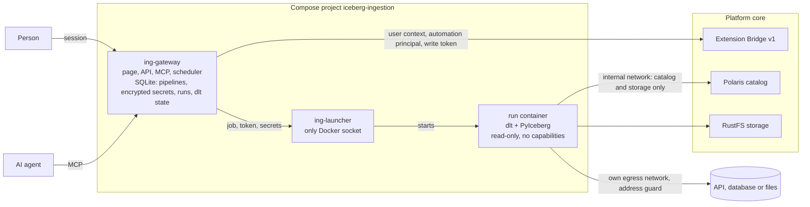

# Ingestion internals

How the [Ingestion (dlt)](../ingestion.md) extension is built. Its source is in [`extensions/ingestion`](https://github.com/sanderdw/iceberg-data-platform/tree/main/extensions/ingestion): its own Compose project (`iceberg-ingestion`), dependencies, images, version and releases. It uses the platform only through the [Extension Bridge](extension-bridge.md) v1, Iceberg REST and S3, so the platform and this extension upgrade independently.

| | |
| --- | --- |
| Engine | dlt 1.31 (Apache-2.0) with its Iceberg destination, PyIceberg, Polaris REST catalog |
| API | [OpenAPI contract](https://github.com/sanderdw/iceberg-data-platform/blob/main/extensions/ingestion/contracts/ingestion-api/v1/openapi.yaml) |
| Agent skill | [`skills/ingestion/SKILL.md`](https://github.com/sanderdw/iceberg-data-platform/blob/main/extensions/ingestion/skills/ingestion/SKILL.md) |

## Architecture



1. A team administrator enables Ingestion for a team environment. The Bridge creates the team's
   automation principal for it.
2. A team administrator creates a pipeline: a source definition, the database and namespace to load
   into, and per resource how to write. Secrets are set apart and never shown again.
3. A writer, or the schedule, starts a run. The gateway asks the Bridge for a short-lived `write`
   token of the team's principal and hands the job, the token, the secrets and dlt's state from the
   previous run to the launcher.
4. The run extracts with dlt, writes with dlt's Iceberg destination through Polaris (vended
   credentials), and marks every table it loaded with the platform's
   [table-property conventions](https://github.com/sanderdw/iceberg-data-platform/blob/main/contracts/bridge/v1/table-properties.md). The catalog shows
   **Produced by dlt**, with a link back to the pipeline.
5. The gateway keeps the run's result, its log (secrets masked) and dlt's new state, so the next
   run continues from the last cursor.

See [DECISIONS.md](https://github.com/sanderdw/iceberg-data-platform/blob/main/extensions/ingestion/DECISIONS.md) for how dlt is used with Polaris and why.

## Isolation

- Each run is its own container from the pinned runner image: read-only, no capabilities, user
  10001, `RUN_MEMORY` (2 GB) and `RUN_CPUS` (2), with dlt's working files on the run's own disk.
- It has a private network with only the platform's catalog and storage, and its own network to
  reach the source. It cannot resolve the platform's other services.
- Sources on loopback, private or link-local addresses (including cloud metadata) are refused when a
  pipeline is saved, and again for every address a run resolves, redirects included. For a demo on a
  laptop, `ING_ALLOW_PRIVATE_SOURCES=true` allows them; a database on the same machine is then
  `host.docker.internal`.
- A run ends 15 minutes before its catalog token expires: 45 minutes with the platform's default
  `POLARIS_TOKEN_LIFETIME` of one hour. Raise that, for example to 7200, for longer loads.
- At most `ING_MAX_CONCURRENT_RUNS` (4) runs at once, `ING_MAX_RUNS_PER_TEAM` (2) per team, and one
  per pipeline. A schedule skips its time while the pipeline is still running.

## Install from source

From the platform directory, register the extension and restart the platform services, then set up
and start the extension:

```bash
uv run python -m scripts.setup --extension ingestion --origin http://localhost:3008 --handshake extensions/ingestion/.env.bridge
docker compose up -d --wait
docker compose -f compose.users.yaml up -d --wait users

cd extensions/ingestion
uv run python -m scripts.setup        # writes .env: launcher token, secret key, port, platform network
docker compose --profile images build
docker compose up -d --wait
```

Open `http://localhost:3008`, sign in, and as a team administrator enable an environment. The user
portal links to the page as **Ingestion (dlt)**. Options are listed in [.env.example](https://github.com/sanderdw/iceberg-data-platform/blob/main/extensions/ingestion/.env.example).
Keep `.env`: `ING_SECRET_KEY` decrypts the pipelines' secrets.

## Development

```bash
uv sync
uv run pytest
uv run ruff check .
uv run python -m scripts.api_contract     # after API changes
uv run python -m scripts.release          # versions, files and secrets
docker build -f runner/Dockerfile -t iceberg-ingestion-runner:dev .
uv run python -m scripts.e2e_smoke        # against a running platform; see its docstring
```
