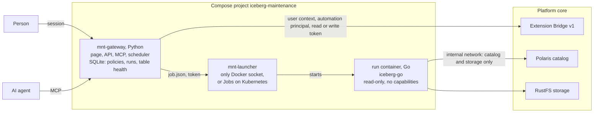

# Maintenance internals

How the [Maintenance](../maintenance.md) extension (beta) is built. Its source is in [`extensions/maintenance`](https://github.com/sanderdw/iceberg-data-platform/tree/main/extensions/maintenance): its own Compose project (`iceberg-maintenance`), dependencies, images, version and releases. It uses the platform only through the [Extension Bridge](extension-bridge.md) v1, Iceberg REST and S3, so the platform and this extension upgrade independently.

| | |
| --- | --- |
| Engine | [Apache iceberg-go](https://github.com/apache/iceberg-go) (Apache-2.0), pinned to a `main` commit, in a static Go runner |
| API | [OpenAPI contract](https://github.com/sanderdw/iceberg-data-platform/blob/main/extensions/maintenance/contracts/maintenance-api/v1/openapi.yaml) |
| Agent skill | [`skills/maintenance/SKILL.md`](https://github.com/sanderdw/iceberg-data-platform/blob/main/extensions/maintenance/skills/maintenance/SKILL.md) |
| Decisions | [`DECISIONS.md`](https://github.com/sanderdw/iceberg-data-platform/blob/main/extensions/maintenance/DECISIONS.md): why Go and iceberg-go, the order of operations, the spike |

## Architecture



1. A team administrator enables Maintenance for a team environment. The Bridge creates the team's automation principal for it.
2. A writer checks a database's health, dry-runs or maintains it; a team administrator's policy and schedule decide what maintenance does.
3. The gateway asks the Bridge for a short-lived token of the team's automation principal: `read` for health checks and dry runs, `write` for maintenance. It stages `job.json` (the database, the policy, the tables and a deadline) and hands both to the launcher.
4. The launcher starts the pinned runner image on a private network with only the catalog and storage (on Kubernetes, a Job in `<namespace>-maintenance-runs`; see [Kubernetes](kubernetes.md)). The runner lists the database's namespaces and tables, and per table runs compaction, dangling deletes, manifests, orphan cleanup and expiry, in that order. Polaris vends storage credentials; the runner reaches RustFS through the internal endpoint.
5. The runner writes `out/result.json`: per table its health before and after, and each action with its status, detail and metrics. The gateway keeps the health per table and the actions per run.

## Job and result

The JSON between gateway and runner is the only boundary, so the runner can change library without touching the gateway. `runner/job.go` defines both; the runner checks the job again, and refuses orphan cleanup younger than a day whatever the job says. A run exits 0 when every table succeeded, 1 when the run or every table failed; a `partial` run has some failed tables.

## Run from source

Next to a running platform, from the platform directory:

```bash
uv run python -m scripts.setup --extension maintenance --origin http://localhost:3013 \
  --handshake extensions/maintenance/.env.bridge
docker compose up -d --wait && docker compose -f compose.users.yaml up -d --wait users
cd extensions/maintenance
uv run python -m scripts.setup
docker compose --profile images build && docker compose up -d --wait
```

For development:

```bash
cd extensions/maintenance
uv sync
uv run pytest && uv run ruff check .
uv run python -m tests.dev_server        # http://localhost:3013/dev/login?user=alice, platform faked
docker run --rm -v "$PWD/runner":/src -w /src golang:1.26.3-bookworm go test ./...
```

The Go tests maintain tables in a local Hadoop catalog: compaction keeps every row, a dry run commits nothing, expiry leaves files for orphan cleanup, and `gc.enabled=false` keeps history. `runner/spike_test.go` (build tag `spike`) runs expiry and orphan cleanup against a real Polaris and RustFS. `scripts/e2e_smoke.py` checks a running installation through MCP, as the CI integration job does.
