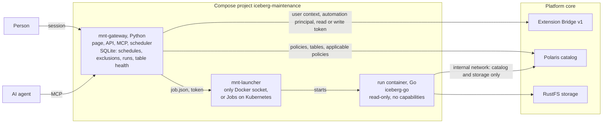

# Maintenance internals

How the [Maintenance](../maintenance.md) extension (beta) is built. Its source is in [`extensions/maintenance`](https://github.com/sanderdw/iceberg-data-platform/tree/main/extensions/maintenance): its own Compose project (`iceberg-maintenance`), dependencies, images, version and releases. It uses the platform only through the [Extension Bridge](extension-bridge.md) v1, Iceberg REST and S3, so the platform and this extension upgrade independently.

| | |
| --- | --- |
| Engine | [Apache iceberg-go](https://github.com/apache/iceberg-go) (Apache-2.0), pinned to a `main` commit, in a static Go runner |
| API | [OpenAPI contract](https://github.com/sanderdw/iceberg-data-platform/blob/main/extensions/maintenance/contracts/maintenance-api/v1/openapi.yaml) |
| Agent skill | [`skills/maintenance/SKILL.md`](https://github.com/sanderdw/iceberg-data-platform/blob/main/extensions/maintenance/skills/maintenance/SKILL.md) |
| Policies | [Apache Polaris policies](https://polaris.apache.org/) of the four system types, read and written through Polaris's Policy API |
| Decisions | [`DECISIONS.md`](https://github.com/sanderdw/iceberg-data-platform/blob/main/extensions/maintenance/DECISIONS.md): why Go and iceberg-go, why policies live in Polaris, the order of operations, commit retries, the spike |

## Architecture



1. A team administrator enables Maintenance for a team environment. The Bridge creates the team's automation principal for it.
2. A team administrator sets the database's policies: the gateway writes Apache Polaris policies with the automation principal's `write` token (below). A writer checks a database's health, dry-runs or maintains it; the policies and the schedule decide what maintenance does.
3. The gateway asks the Bridge for a short-lived token of the team's automation principal: `read` for health checks and dry runs, `write` for maintenance. With it, it lists the database's namespaces and tables and asks Polaris which policies apply to each table (`GET …/applicable-policies`). It stages `job.json` (the database, each table with its policies, and a deadline) and hands both to the launcher.
4. The launcher starts the pinned runner image on a private network with only the catalog and storage (on Kubernetes, a Job in `<namespace>-maintenance-runs`; see [Kubernetes](kubernetes.md)). Per table, the runner runs compaction, dangling deletes, manifests, orphan cleanup and expiry, in that order, each by its policy. A commit that conflicts with another writer is planned again and retried. Polaris vends storage credentials; the runner reaches RustFS through the internal endpoint.
5. The runner writes `out/result.json`: per table its health before and after, and each action with its status, detail, metrics and the policy behind it. The gateway keeps the health and the applied policies per table and the actions per run.

## Policies in Polaris

Polaris 1.9 stores and resolves maintenance policies and runs none of them. Maintenance uses its Policy API (`maintenance/polaris.py`) and keeps no policy of its own.

| What | In Polaris |
| --- | --- |
| The database's policy | One policy per system type attached to the catalog (`{"type": "catalog"}`). Maintenance's own are `snapshot-expiry`, `data-compaction`, `metadata-compaction` and `orphan-file-removal` in the namespace `_maintenance`; one another tool attached is updated in place |
| An exclusion | `excluded-<type>`, a policy with `{"enable": false}` per type, attached to the namespace or table (`table-like`) |
| What applies to a table | `GET /api/catalog/polaris/v1/{database}/applicable-policies?namespace=…&target-name=…`: Polaris's answer, table over namespace over catalog |
| Concurrent edits | Every update sends `current-policy-version`; Polaris answers 409 when the policy changed, which the API returns as `revision_conflict` |

`maintenance/policy.py` maps the API's settings onto policy content and back. The keys are Polaris's documented ones and Apache Iceberg's `rewrite_data_files` options; `max-input-bytes-per-run` and `min-count-to-merge` are Maintenance's own. Polaris cannot list where a policy is attached, so the exclusions Maintenance made are also in SQLite. The automation principal's catalog role `writer` holds `CATALOG_MANAGE_CONTENT`, which in Polaris 1.9 includes creating, changing, attaching and detaching policies; `reader` can resolve the policies of the tables it reads. No other grant is needed.

## Job and result

The JSON between gateway and runner is the only boundary, so the runner can change library without touching the gateway. `runner/job.go` defines both: the job names each table with its identifier and, per policy type, the settings, the Polaris policy (`name`, `namespace`, `version`, `appliedAt`) and why the gateway did not apply it, if so. The runner checks the job again, and refuses orphan cleanup younger than a day whatever the job says. A run exits 0 when every table succeeded, 1 when the run or every table failed; a `partial` run has some failed tables.

Since Polaris 1.8 a commit that loses to a concurrent writer is a retryable 409. iceberg-go retries most commits itself (the table properties `commit.retry.*`). The runner retries the ones it gives back, such as compaction that removes delete files: it reloads the table, plans the operation again and commits, up to 4 tries with backoff and jitter, within the run's deadline (`runner/retry.go`).

## API

The REST API (`maintenance/api.py`) and the MCP server (`maintenance/mcp_server.py`) call the same service methods (`maintenance/services.py`), and a tool returns exactly what its operation returns. The API follows the conventions of the platform's extensions:

- Fields are camelCase in REST; tool names and tool parameters are snake_case.
- A list is an object with one plural key: `{"databases": [...]}`, `{"runs": [...]}`, `{"environments": [...]}`, and `{"tables": [...], "total": n}` for table health, where `limit` is 500 by default and at most 5000.
- Every response is built field by field by a `public_*` function; no stored row and no Bridge answer is passed on. Times go through `timestamp()`: RFC 3339, UTC, milliseconds.
- A run has one shape. `POST /databases/{database}/runs` answers 202 with the run as `GET /runs/{run}` returns it, with `results`; both take `wait` (0 to 600 seconds), and waiting never fails. A list of runs leaves `results` out.
- An error is `{"error", "code"}`, also for an unknown path (`not_found`), a wrong method (`method_not_allowed`) and an unexpected failure (`internal_error`).

| Operation | Method and path | Tool |
| --- | --- | --- |
| `whoami` | `GET /me` | `whoami` |
| `listEnvironments`, `enableEnvironment`, `disableEnvironment` | `GET /teams/{team}/environments`, `POST` and `DELETE /teams/{team}/environments/{environment}` | `list_environments`, `enable_environment`, `disable_environment` |
| `listDatabases` | `GET /databases` | `list_databases` |
| `listTableHealth` | `GET /tables` | `list_table_health` |
| `getTableHealth` | `GET /databases/{database}/tables/{table}` | `get_table_health` |
| `getPolicy`, `updatePolicy`, `deletePolicy` | `GET`, `PATCH` and `DELETE /databases/{database}/policy` | `get_policy`, `update_policy`, `delete_policy` |
| `setSchedule`, `deleteSchedule` | `PUT` and `DELETE /databases/{database}/schedule` | `set_schedule`, `delete_schedule` |
| `runMaintenance` | `POST /databases/{database}/runs` | `inspect_database` (`inspect`, `dry-run`) and `run_maintenance` (`maintain`) |
| `listRuns` | `GET /databases/{database}/runs` | `list_runs` |
| `getRun`, `getRunLogs`, `cancelRun` | `GET /runs/{run}`, `GET /runs/{run}/logs`, `POST /runs/{run}/cancel` | `get_run`, `get_run_logs`, `cancel_run` |

Starting a run is one operation with two tools, so that only maintaining is marked destructive. A database's schedule is Maintenance's own, in SQLite, and set on its own; it needs a policy, and it runs at most once an hour. The extension's [decisions](https://github.com/sanderdw/iceberg-data-platform/blob/main/extensions/maintenance/DECISIONS.md) explain both.

## Run from source

Next to a running platform, from the platform directory:

```bash
uv run python -m scripts.setup --extension maintenance --origin http://localhost:3013 \
  --handshake extensions/maintenance/.env.bridge
docker compose up -d --wait && docker compose -f compose.users.yaml up -d --wait users
cd extensions/maintenance
uv run python -m scripts.setup
docker compose --profile images build && docker compose up -d --wait
```

For development:

```bash
cd extensions/maintenance
uv sync
uv run pytest && uv run ruff check .
uv run python -m tests.dev_server        # http://localhost:3013/dev/login?user=alice, platform and Polaris faked
docker run --rm -v "$PWD/runner":/src -w /src golang:1.27.4-bookworm go test ./...
```

The Python tests run the gateway against fakes of the Bridge, the launcher and Polaris (`tests/conftest.py`): the Policy API with versions, attachments and applicable-policy resolution. The Go tests maintain tables in a local Hadoop catalog: compaction keeps every row, a dry run commits nothing, expiry leaves files for orphan cleanup, `gc.enabled=false` keeps history, each action names its policy, and a conflicting compaction is planned again against the new snapshot. `runner/spike_test.go` (build tag `spike`) runs expiry and orphan cleanup against a real Polaris and RustFS. `scripts/e2e_smoke.py` checks a running installation through MCP, as the CI integration job does.
