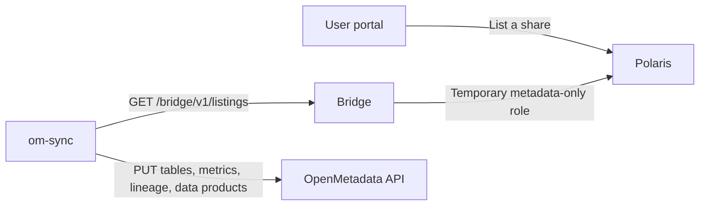

# OpenMetadata internals

The extension lives in [`extensions/openmetadata`](https://github.com/sanderdw/iceberg-data-platform/tree/main/extensions/openmetadata). It is one service, `om-sync`, that uses the platform only through the [Extension Bridge](extension-bridge.md) capability `listings`, with its service-account token. It never calls Polaris or storage.

- **Core side.** A listed share's principal is never activated. For each listing request the Bridge creates a temporary catalog role with only `TABLE_READ_PROPERTIES`, `VIEW_READ_PROPERTIES` and `SEMANTIC_MODEL_READ` on the listed objects, reads their definitions without storage credentials, and deletes the role. See the [resource model](resource-model.md#data-shares).
- **Polling.** Every `OM_POLL_SECONDS` the extension reads the listing summary and fetches listings whose `version` changed, with `If-None-Match`. Schema and semantic model edits don't change the summary, so every `OM_FULL_SYNC_SECONDS` it publishes everything again.
- **Reconcile.** Upserts are idempotent PUTs in dependency order: domain, teams, database service, database, schema, tables and views, metrics, lineage, data product and its assets. Then everything under this installation's prefix that is no longer listed is removed. There is no state file, so a restart is one full sync. When a listing can't be read, nothing is removed in that sync.
- **OpenMetadata 2.0.5.** Database services are `CustomDatabase` without a connection, tables have type `Iceberg`, data product assets are added through `/assets/add`, and a PUT restores a soft-deleted entity. A bot's PUT never replaces a description that is already set, so changed descriptions follow as a JSON Patch. A foreign key needs its table, so referred tables are published first.
- **ER diagram.** Open-source OpenMetadata draws none (Collate does) and renders no Mermaid, so the data product's description carries an SVG drawn from the listed keys, as a Markdown data-URI image, with the relationships as a table. The [decisions](https://github.com/sanderdw/iceberg-data-platform/blob/main/extensions/openmetadata/DECISIONS.md) list every API detail.
- **Tests.** Unit tests run against a fake OpenMetadata and a fake Bridge on every pull request. The integration job runs the core from the same commit with a local OpenMetadata 2.0.5 on pushes to `main` and on demand.
