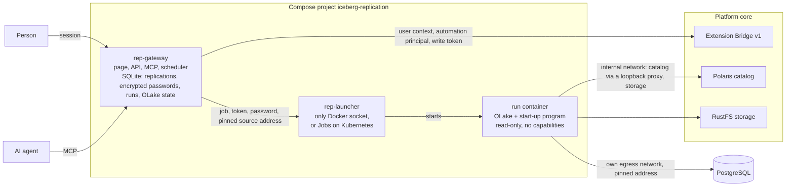

# Replication internals

How the [Replication (OLake)](../replication.md) extension is built. Its source is in [`extensions/replication`](https://github.com/sanderdw/iceberg-data-platform/tree/main/extensions/replication): its own Compose project (`iceberg-replication`), dependencies, images, version and releases. It uses the platform only through the [Extension Bridge](extension-bridge.md) v1, Iceberg REST and S3, so the platform and this extension upgrade independently.

| | |
| --- | --- |
| Engine | OLake v1.2.0 (Apache-2.0): a Go reader per source and a Java Iceberg writer, used through its command line |
| API | [OpenAPI contract](https://github.com/sanderdw/iceberg-data-platform/blob/main/extensions/replication/contracts/replication-api/v1/openapi.yaml) |
| Agent skill | [`skills/replication/SKILL.md`](https://github.com/sanderdw/iceberg-data-platform/blob/main/extensions/replication/skills/replication/SKILL.md) |

## Architecture



1. A team administrator enables Replication for a team environment. The Bridge creates the team's
   automation principal for it.
2. A team administrator creates a replication: the source connection, the database and namespace to
   write into, and the delete mode. The password is set apart and never shown again.
3. A writer checks the source: a run of kind `check` runs OLake's `check` (its prerequisites) and
   `discover` (the tables, with keys and cursor columns). The administrator chooses tables from it.
4. A writer, or the schedule, starts a sync. The gateway resolves the source host, checks the
   address, asks the Bridge for a short-lived `write` token and hands the job, the token, the
   password, the pinned address and OLake's state from the previous run to the launcher.
5. The run writes OLake's configuration files, runs `discover` and `sync`, and stops OLake before
   the run's time limit. OLake reads the source and writes through Polaris with vended credentials;
   a loopback proxy points them at the internal storage. The run then marks every table with the
   platform's [table-property conventions](https://github.com/sanderdw/iceberg-data-platform/blob/main/contracts/bridge/v1/table-properties.md).
6. The gateway keeps the run's counts, its log (secrets masked) and OLake's new state: the change
   log position and any chunks of a first copy still to do.

See [DECISIONS.md](https://github.com/sanderdw/iceberg-data-platform/blob/main/extensions/replication/DECISIONS.md) for why OLake, the delete modes, what was verified and the known limits.

## Isolation

- Each run is its own container from the pinned runner image: OLake's image with a start-up program
  in Python's standard library, read-only, no capabilities, user 10001, `RUN_MEMORY` (4 GB) and
  `RUN_CPUS` (2). OLake's row index and Java temporary files are on the run's own disk.
- It has a private network with only the platform's catalog and storage, and its own network to
  reach the source. It cannot resolve the platform's other services.
- The gateway resolves the source host before every run. Loopback, link-local, multicast and
  reserved addresses are refused; private addresses only inside `REP_ALLOWED_SOURCE_NETWORKS`;
  `REP_ALLOW_PRIVATE_SOURCES=true` lifts the rules for demos. The launcher pins the checked address
  in the run (`extra_hosts`, or `hostAliases` on Kubernetes), so OLake never resolves the name.
- On Kubernetes (`LAUNCHER_BACKEND=kubernetes`, set by the chart) a run is a Job in the namespace
  `<platform namespace>-replication-runs`, with the same limits. A NetworkPolicy takes the place of
  both networks: the catalog, storage, the launcher's job endpoints, public addresses and
  `runs.allowedSourceNetworks`. The runner fetches its job and returns `out/` through the launcher
  with a one-run ticket (`runner/remote.py`); see [Kubernetes](kubernetes.md).
- The run stops OLake 3 minutes before its time limit, which ends 15 minutes before its catalog
  token expires. At most `REP_MAX_CONCURRENT_RUNS` (4) runs at once, `REP_MAX_RUNS_PER_TEAM` (2)
  per team, and one per replication, a source check included.

## Install from source

From the platform directory, register the extension and restart the platform services, then set up
and start the extension:

```bash
uv run python -m scripts.setup --extension replication --origin http://localhost:3014 --handshake extensions/replication/.env.bridge
docker compose up -d --wait
docker compose -f compose.users.yaml up -d --wait users

cd extensions/replication
uv run python -m scripts.setup        # writes .env: launcher token, secret key, port, platform network
docker compose --profile images build
docker compose up -d --wait
```

Open `http://localhost:3014`, sign in, and as a team administrator enable an environment. The user
portal links to the page as **Replication (OLake)**. Options are listed in [.env.example](https://github.com/sanderdw/iceberg-data-platform/blob/main/extensions/replication/.env.example).
Keep `.env`: `REP_SECRET_KEY` decrypts the stored passwords.

## Development

```bash
uv sync
uv run pytest                              # the runner's tests use a fake OLake command line
uv run ruff check .
uv run python -m scripts.api_contract     # after API changes
uv run python -m tests.dev_server         # the page with the platform faked: http://localhost:3014/dev/login
docker build -f runner/Dockerfile -t iceberg-replication-runner:dev .
uv run python -m scripts.e2e_smoke        # against a running platform; see its docstring
```
