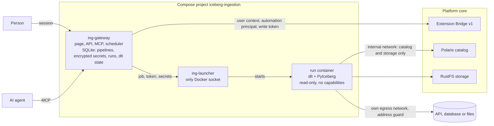

# Ingestion (dlt) for the Iceberg Data Platform

Get data in: declarative [dlt](https://dlthub.com/docs) pipelines that load REST APIs, PostgreSQL
and MySQL/MariaDB tables, and CSV, JSONL or Parquet files into a team's Apache Iceberg databases,
on demand or on a schedule. People use the pipelines page; AI agents and scripts use the same
capabilities through MCP and a REST API.

This is an extension: its own Compose project (`iceberg-ingestion`), dependencies, images, version
and releases. It uses the platform only through the **Extension Bridge v1** (`contracts/bridge` in
the platform repository), Iceberg REST and S3, so the platform and this extension upgrade
independently.

| | |
| --- | --- |
| Engine | dlt 1.31 (Apache-2.0) with its Iceberg destination, PyIceberg, Polaris REST catalog |
| Sources | `rest_api`, `sql_database` (PostgreSQL, MySQL, MariaDB), `filesystem` (HTTPS, S3) |
| API | `http://localhost:3008/api/v1` ([contract](contracts/ingestion-api/v1/openapi.yaml)) |
| MCP | `http://localhost:3008/mcp` (Keycloak sign-in through the `ext-ingestion-mcp` client) |
| Page | `http://localhost:3008` (pipelines, secrets, runs, logs, schedules) |

## Architecture



1. A team administrator enables Ingestion for a team environment. The Bridge creates the team's
   automation principal for it.
2. A team administrator creates a pipeline: a source definition, the database and namespace to load
   into, and per resource how to write. Secrets are set apart and never shown again.
3. A writer, or the schedule, starts a run. The gateway asks the Bridge for a short-lived `write`
   token of the team's principal and hands the job, the token, the secrets and dlt's state from the
   previous run to the launcher.
4. The run extracts with dlt, writes with dlt's Iceberg destination through Polaris (vended
   credentials), and marks every table it loaded with the platform's
   [table-property conventions](../../contracts/bridge/v1/table-properties.md). The catalog shows
   **Produced by dlt**, with a link back to the pipeline.
5. The gateway keeps the run's result, its log (secrets masked) and dlt's new state, so the next
   run continues from the last cursor.

See [DECISIONS.md](DECISIONS.md) for how dlt is used with Polaris and why.

## Pipelines

A pipeline belongs to one team and environment, and loads into one of the team's databases there,
into one namespace (dlt's dataset, such as `raw_crm`). Pipelines are configuration, never code.

| Source type | What it reads |
| --- | --- |
| `rest_api` | dlt's declarative REST source: `base_url`, sign-in (bearer, API key, basic), a paginator, endpoints with `data_selector`, parameters, nested endpoints and an incremental parameter |
| `sql_database` | Tables of a PostgreSQL (pg8000) or MySQL/MariaDB (PyMySQL) database: host, port, database, user, a secret password, TLS (`verify-full`, `require` or `disable`), optionally an incremental cursor column per table |
| `filesystem` | One CSV, JSONL or Parquet file over HTTPS, or files matching a pattern in S3-compatible storage, optionally only those changed since the last run |

Per resource (endpoint, table or file), `writeDisposition` is `append`, `replace` or `merge`
(upsert on `primaryKey`), and `partition` lists identity partition columns. Replace and merge keep
the table and its identity, so data shares and descriptions stay.

dlt adds the columns `_dlt_load_id` and `_dlt_id` to each table, and child tables named
`<table>__<field>` for nested lists. Its own bookkeeping tables stay with the run, never in your
namespace.

Secrets (API keys, tokens, passwords) never go in a definition. Refer to them as
`"$secret:<name>"` and set them on the pipeline's page, with `PUT /api/v1/pipelines/{id}/secrets`,
or with the MCP tool `set_pipeline_secrets`. They are encrypted, write-only and masked in run logs.
Changing where a pipeline connects removes its secrets.

Templates to start from: CBS StatLine open data (REST, paginated OData), a PostgreSQL table
incremental on `updated_at`, MySQL or MariaDB tables, and airport codes as CSV over HTTPS.

| Role in the team | Allowed |
| --- | --- |
| reader | View pipelines, runs, logs and schedules; validate a definition |
| writer | Also run pipelines and stop runs |
| admin, bucket-admin | Also create, change and delete pipelines, set secrets and schedules, enable environments |

## Isolation and limits

- Each run is its own container from the pinned runner image: read-only, no capabilities, user
  10001, `RUN_MEMORY` (2 GB) and `RUN_CPUS` (2), with dlt's working files on the run's own disk.
- It has a private network with only the platform's catalog and storage, and its own network to
  reach the source. It cannot resolve the platform's other services.
- Sources on loopback, private or link-local addresses (including cloud metadata) are refused when a
  pipeline is saved, and again for every address a run resolves, redirects included. For a demo on a
  laptop, `ING_ALLOW_PRIVATE_SOURCES=true` allows them; a database on the same machine is then
  `host.docker.internal`.
- A run ends 15 minutes before its catalog token expires: 45 minutes with the platform's default
  `POLARIS_TOKEN_LIFETIME` of one hour. Raise that, for example to 7200, for longer loads.
- At most `ING_MAX_CONCURRENT_RUNS` (4) runs at once, `ING_MAX_RUNS_PER_TEAM` (2) per team, and one
  per pipeline. A schedule skips its time while the pipeline is still running.

## Install

From the platform directory, register the extension and restart the platform services, then set up
and start the extension:

```bash
uv run python -m scripts.setup --extension ingestion --origin http://localhost:3008 --handshake extensions/ingestion/.env.bridge
docker compose up -d --wait
docker compose -f compose.users.yaml up -d --wait users

cd extensions/ingestion
uv run python -m scripts.setup        # writes .env: launcher token, secret key, port, platform network
docker compose --profile images build
docker compose up -d --wait
```

Open `http://localhost:3008`, sign in, and as a team administrator enable an environment. The user
portal links to the page as **Ingestion (dlt)**. Options are listed in [.env.example](.env.example).
Keep `.env`: `ING_SECRET_KEY` decrypts the pipelines' secrets.

## Connect an AI agent

```bash
claude mcp add --transport http --client-id ext-ingestion-mcp --callback-port 3010 iceberg-ingestion http://localhost:3008/mcp
```

The [ingestion skill](skills/ingestion/SKILL.md) guides an agent from a template to a first load.
Register the user portal's MCP server too, to read the loaded tables.

## Develop

```bash
uv sync
uv run pytest
uv run ruff check .
uv run python -m scripts.api_contract     # after API changes
uv run python -m scripts.release          # versions, files and secrets
docker build -f runner/Dockerfile -t iceberg-ingestion-runner:0.1.0 .
uv run python -m scripts.e2e_smoke        # against a running platform; see its docstring
```

Version 0.1.0 is batch only, with the three declarative sources. Custom Python pipelines, dlt's
verified sources and change data capture are not included.

## License

Apache-2.0. See [NOTICE](NOTICE) and [THIRD_PARTY_NOTICES.md](THIRD_PARTY_NOTICES.md).
